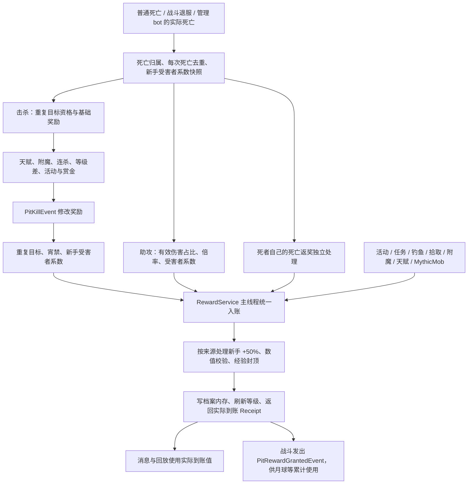
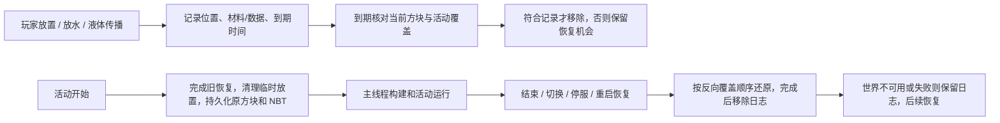

# 天坑经验、bot、方块与清理修复 — 2026-09-05

基于当前 ThePitPremium 工作区修复。工作区原有大量未提交改动，本轮保留这些改动，构建产物也包含当前工作区内容。本地修复与验证完成后，已按用户授权部署到 RMC 的 `ThePit-1`，于 2026-09-05 17:46（UTC+8）恢复运行。

## 新手规则

沿用现有等级范围：**真人、0 转生、等级低于 `noob-protect.level`（默认 120）**。120 级或已转生退出新手范围，管理的 bot 不属于新手。奖励开关与原有战斗保护开关独立。

| 场景 | 新规则 |
|---|---|
| 新手获得玩法经验和金币 | ×1.5，即 +50% |
| 击杀或助攻击杀新手 | 该笔击杀/助攻经验和金币 ×0.7，即 -30% |
| 新手击杀另一名新手 | 两项乘算，×1.5×0.7=1.05；其他已有玩法倍率仍单独计算 |
| 非新手击杀非新手 | 无新手倍率 |
| 满级经验 | 封顶 120 级，只显示实际新增经验；金币继续正常结算 |
| 邮件、管理员发放、已累计奖励兑现 | 不再附加新手倍率，避免补发、返还时重复加成 |
| 转账、交易、退款、偷取资金 | 不按玩法收入增加 50% |

`plugins/ThePitPremium/custom.yml` 在加载时补齐默认配置：

```yaml
noob-protect:
  level: 120
noob-rewards:
  enabled: true
  multiplier: 1.5
  killed-multiplier: 0.7
```

这里列出的是相关键，不应拿这个片段覆盖完整配置文件。受害者的新手系数在死亡开始时确定，避免死亡返奖把其升到 120 级后让本次击杀绕过 -30%。新手登录提示显示配置中的实际比例，并提供 `%pit_noob%`、`%pit_noob_tag%`、`%pit_reward_multiplier%` 占位符。

## 修复后的经验链路



`RewardService` 是统一入账入口，不是新的逐笔数据库账本。普通奖励仍沿用原有档案保存机制；本次没有建立跨数据库事务或新的周期自动保存系统。

| 问题 | 已落实的修复 |
|---|---|
| 无输出、新登录、只逃跑的真人奖励骤降 | 移除按近期输出缺失执行的 inactive 奖励扣减。旧 `inactive-kill-reward` 配置已标记废弃 |
| 战斗退服先清记录 | 先结算死亡，再清理会话信息；真实玩家重登不清空重复目标限制 |
| 助攻消耗重复击杀次数 | 只有真实击杀计数；助攻读取政策但不增加次数，零贡献不结算 |
| 重复目标时间窗不准确 | 改为同一 UUID 对最近 10 分钟滚动记录。重复目标仍限制额外进度与掉落，真人保留无活动加成的基础奖励下限 |
| 助攻显示倍率与到账不同、小伤害被截断 | 全局倍率在入账前计算，伤害占比保留小数，消息读取 Receipt |
| 真伤、TNT 归属缺失或伤害虚高 | 补全伤害来源；致死用的合成巨量伤害不进入贡献，贡献按剩余生命/吸收上限截取 |
| 山丘之王、黄金头盔只修改提示 | `PitKillEvent` 移到最终入账之前；新增独立到账通知事件 |
| 击杀者反刷限制吞掉死者返奖 | 独立执行死者回调，补无击杀者的超速/月球返奖，隔离单个死亡天赋异常 |
| 赏金重复入账、覆盖基础金币 | 赏金纳入一次最终金币结算，清除提前发放路径 |
| 金币误用经验、经验被当金币记录 | 修正 Genesis 恶魔金币来源、Sweaty/Cake 分项记录及装备加成条件 |
| 倍率天赋异常 | 修正 Grim Reaper 异步负倍率、Coop Cat、Hermit、Super Streaker 每十杀重复触发、Gold Stack 条件 |
| 月球返奖重复放大 | 累计实际到账经验，兑现时不重复附加新手倍率 |
| 等级条、溢出与异常数值 | 先写新经验再刷新；拒绝非有限经验；按当前转生封顶；反序列化未加载档案时不提前按错误转生裁剪 |

已接入统一奖励入口的非战斗来源包括 QuickMath、龙蛋、下水道、Cake、大活动金币奖励、国王任务与普通任务、空投、钓鱼相关天赋、Combo XP、Recon/Olympus、连杀奖励和 MythicMob 等。管理员设级、转生重置、初始化及邮件回滚等直接数值写入继续保留其原本语义。

QuickMath 的判题、去重、前五名限制和发奖现在全部在主线程执行，并拒绝旧题/结束后的请求。邮件领取将奖励与领取凭据先保存到同一玩家档案，再确认邮件；重试和重登后重复领取由凭据拦截。邮件与玩家保存仍是两个 Mongo 操作；领取关键保存当前同步执行，数据库延迟可能影响该次交互。

## bot 生命周期

- 按管理器登记的实际 NPC 实体和档案识别受管 bot；没有发现需要把普通真人档案改回 `bot=false` 的证据。
- 移除根据一次伤害预测死亡、提前发奖以及恢复已取消伤害的逻辑，按实际死亡入口结算，每条生命只结算一次。
- 撤销待生成/待重生任务，保留销毁过程中的身份直至 NPC 清理完成，再清除战斗状态与缓存。
- NPC 档案缺失时恢复管理状态，避免写入共享空档案；NPC 加入/离开不走真人档案保存与 Redis 会话路径。

本次不把“低活跃”包装成通用外部自动化账号识别。用户反馈对应的误伤扣减已移除。

## 方块与清理链路



- 修复负 Z 坐标编码导致 X 翻转；迁移旧格式日志，恢复新旧区域。
- 在途恢复记录保留在日志中；停服同步处理；世界/区块暂不可用或恢复失败不会被记作已完成；重叠区域失败重试仍保留原捕获顺序。
- 原始箱子、告示牌等块实体的 NBT 随日志保存并恢复。旧日志没有 NBT 的方块无法凭空补回历史内容。
- 活动区域覆盖玩家临时方块时，旧到期记录不会误删活动建筑；方块材料及数据不符时不盲删。
- 水桶、水流、岩浆及 Portable Pond 接入到期清理；Portable Pond 不覆盖既有地形，修正第四次使用失效。
- 补齐 Spire 塔体/墙/传送门、Squads、Care Package、Dragon Egg、BlockHead 的恢复记录；BlockHead 使用增量日志。
- 活动工厂统一结束普通、大型和预备活动，处理激活失败与停服；KOTH、DamagePlus、Dragon Egg 等取消上一轮结束任务。
- Spire 延迟装备/传送校验活动轮次，结束时立即恢复玩家背包，防止旧任务随后覆盖背包。
- 实体移除失败保留记录；Auction 日志异常不再中断退款，补齐离线退款和小数金额，停服时采用同步保存。

## 验证与产物

执行 `./gradlew build --console=plain`，结果 **BUILD SUCCESSFUL**；该任务包含 `test` 和 `shadowJar`。共 **47 项测试通过，0 失败、0 错误、0 跳过**：

| 范围 | 测试数 |
|---|---:|
| 奖励数学、新手、封顶、重复目标 | 14 |
| 战斗实际到账与死亡回调 | 4 |
| bot 生命周期 | 7 |
| 方块、实体、清理、活动生命周期 | 10 |
| 连杀奖励 | 4 |
| 邮件领取重试 | 4 |
| QuickMath 主线程判题及重复提交 | 4 |

清理测试包含 NBT 压缩、落盘、重读与还原；测试隔离实时 NMS 世界查询，并未启动完整 Minecraft 服务端。新手规则的配置加载与真实助攻全链叠加通过源码核验，尚无独立服务器集成测试。`git diff --check` 通过。

产物：[ThePitPremium-3.93.jar](//wsl.localhost/Ubuntu-26.04/home/kiromorii/Remiaft/ThePitPremium/build/libs/ThePitPremium-3.93.jar)，大小 7,483,281 字节。

```text
SHA-256: d4255b6120b5e7289a1a54ec098fac23a36411706c32d3008b7c1eb2599bab18
```

已核对内嵌 `plugin.yml` 的名称/版本/入口及 ProtocolLib 必需依赖；新增奖励、bot、清理类均存在；Nashorn 与隔离后的 ASM 已打包；全部 class 的最高版本为 55（Java 11）。未生成容易误用的薄 JAR。

服内尚未完整验证的部分：真实 Citizens 战斗死亡/重生、FAWE 大型地图变更、新版运行后的异常重启恢复、Mongo 保存延迟和跨插件监听顺序。启动和目录注册的通过不代表每条玩法链路都已完成真人实测。

## 线上部署回执

- 目标：RMC / `ThePit-1`，目录 `/home/remiaft/RMCServer/ThePit-1`。
- 在现有 `plugins/update` 目录暂存、校验后，通过 Bukkit 标准更新流程替换唯一主插件 `plugins/ThePitPremium-3.93.jar`。新旧 JAR 没有同时留在插件加载目录，更新临时文件已消费。
- 17:43:45 控制台执行 `reboot 2m reboot-经验与方块修复-新手奖励更新`，使用天坑内置公告、标题和倒计时；17:44:07 又明确广播 `reboot - 天坑更新重启倒计时已开始，请稍后重新进入。`。
- 17:45:46 旧实例正常停止，随后记录保存玩家、世界和区块；旧 Java 进程已退出。管理器使用现有 `auto_restart=true` 自动拉起。
- 17:46:24 新版 ThePitPremium 启用；17:46:26 bot 管理器就绪；17:46:27 服务端输出 `Done`。
- 17:46:33 后端心跳、健康刷新及 `STANDALONE_GAME → ThePit-1` 注册完成；17:46:34 后端检测真实 Spiter 启动，中国和海外代理均收到启动确认。
- Java 17 新进程 PID `3012661`，监听 `127.0.0.1:28354`；Minecraft 状态协议返回 `RMCGot 1.8.8 / protocol 47`。控制台确认 ThePitPremium 版本 3.93，线上 JAR SHA-256 与上方产物一致。
- 线上 `custom.yml` 已补齐并确认 `noob-rewards.enabled=true`、`multiplier=1.5`、`killed-multiplier=0.7`，沿用 `noob-protect.level=120`。
- 旧进程停止时 Spiter 记录一条 executor 已关闭信息；启动窗口代理曾有连接拒绝/超时，17:46:34 READY 确认后未发现新增天坑连接错误。真实玩家传送未由本次操作模拟。
